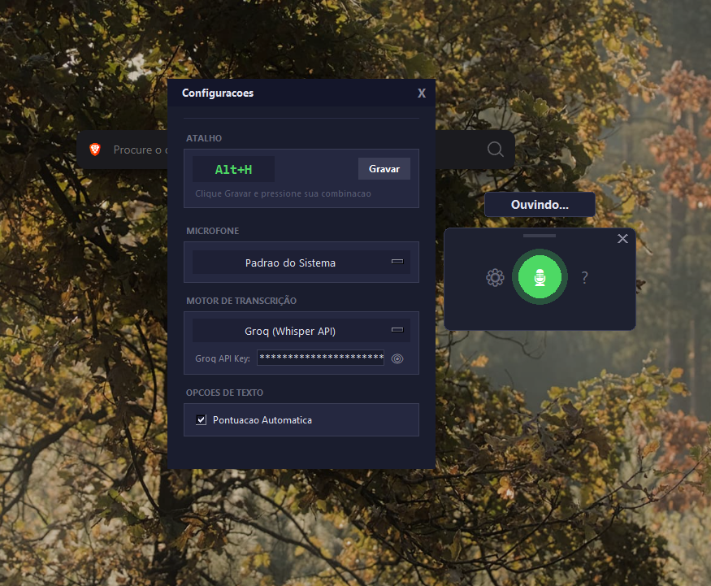
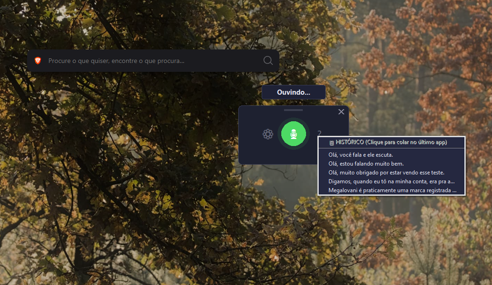

# VoiceDictation (Voice Detection Transcribe)

<div align="center">
  <a href="https://github.com/Mattys03/VoiceDictation/releases/latest">
    
  </a>
</div>


**VoiceDictation** é um utilitário ultraleve para Windows escrito em **C++20 / Win32 nativo** (zero dependências externas ou runtime Python necessário para o usuário final) que transcreve sua voz em tempo real e injeta o texto automaticamente no campo/chat ativo em qualquer janela do sistema.

---

## ⚡ Destaques da v2.0 (Nativo C++)

* **Plug & Play (1 clique):** Baixe apenas o `VoiceDictation.exe` na aba **[Releases](https://github.com/Mattys03/VoiceDictation/releases/latest)** e execute direto. Já vem configurado no **motor gratuito do Google** em modo **`AUTO`** — não exige criar nem colar nenhuma chave de API para usar.
* **Resiliência Total sob Carga:** Processo nativo x64 estático (`~5 MB` de RAM, prioridade `ABOVE_NORMAL`, threads dedicadas de áudio/rede e Zero-GIL). Continua respondendo instantaneamente e sem congelar mesmo com CPU/RAM em 100%.
* **Cola Direto no Local Certo:** Sistema de clipboard isolado que preserva o item anterior do seu `Ctrl+V`, garante a colagem exata do que foi ditado e restaura seu clipboard com segurança.
* **Groq Whisper API (Opcional):** Se você já possuir uma chave Groq (`gsk_...`), abra **Configurações (`⚙`)**, troque o motor para **`Groq (Whisper API)`**, cole sua chave pessoal (armazenada apenas no seu `config.json` local) e desfrute também de **Revisão Inteligente com IA** (remove repetições, gaguejos e autocorreções, organiza e deixa a frase clara e sem erros no seu tom natural) e tradução automática (`PT → EN`, `PT → ES`).
* **Controle de Reticências (`...`):** Opção direta em Configurações (`Permitir reticências (...)`) para desmarcar e eliminar todos os `...` que pausas na fala costumam gerar.
* **Interface Moderna Dark & Light:** Pílula flutuante vetorial em GDI+ com indicador de decibéis, ícone de globo em **`AUTO`**, popups escuros/claros coordenados sem janelas brancas e trava anti-duplicação ao clicar nos menus.
* **Controle de Inicialização no Windows:** Opção **`Iniciar com o Windows`** diretamente em Configurações (desmarcada por padrão em novas instalações).

---

## 🚀 Instalação e Uso Rápido (Para Usuários)

1. Clique no botão **[Download VoiceDictation.exe](https://github.com/Mattys03/VoiceDictation/releases/latest)** acima e baixe o executável mais recente (`VoiceDictation.exe` ou o `.zip`).
2. Dê dois cliques em `VoiceDictation.exe` — nenhuma instalação adicional é necessária.
3. Posicione o cursor em qualquer editor, navegador, chat ou IDE e aperte **`Alt + H`** (ou clique no botão do microfone).
4. Fale normalmente e aperte **`Alt + H`** (ou o botão verde) novamente para transcrever e colar o texto.

> **Configuração opcional:** O arquivo `config.json` é criado automaticamente ao lado do `.exe` assim que você altera alguma preferência em **`⚙`**. O padrão inicial já vem pronto com `engine = "Google (Gratuito)"`, `language = "auto"`, `theme = "dark"` e `auto_start = false`.

---

## 🛠️ Arquitetura Técnica

* **Captura de Áudio (`native/audio_engine.cpp`):** Captura PCM via Windows Multimedia (`winmm`), análise energética de fala e recorte de silêncio nas bordas + codificador **FLAC lossless verbatim** nativo para Google Speech / **WAV** para Groq.
* **Injeção de Texto (`native/injector.cpp`):** Detecção precisa da janela/foco (`GetForegroundWindow` / thread input attach), envio sincronizado de `Ctrl+V` via `SendInput` (`MapVirtualKeyW`) e restauração segura do clipboard anterior.
* **Rede Assíncrona (`native/net_client.cpp`):** Requisições HTTPS via `WinHTTP` nativo com conexões persistentes/prewarm e worker thread dedicada fora da UI thread.
* **UI Vetorial GDI+ (`native/main.cpp`, `native/settings_ui.cpp`, `native/popup_card.cpp`, `native/theme.h`):** Janelas layered per-pixel alpha, menus pop-up customizados sem rebarbas de tema do Windows, paleta completa Dark/Light e alternância limpa de idioma (`AUTO`, `PT-BR`, `PT → EN`, `PT → ES`), histórico (`?`) e configurações (`⚙`).

---

## 💻 Compilando do Código-Fonte

Requisitos: **Visual Studio 2022** (ou Build Tools com Desktop C++ x64).

```cmd
git clone https://github.com/Mattys03/VoiceDictation.git
cd VoiceDictation
native\build.bat
```

O script `native\build.bat` compila e executa os testes unitários nativos (`native\test_native.exe`) e gera o binário estático `VoiceDictation.exe` na raiz do repositório.

---

## 🎥 Demonstração e Capturas

<video src="https://raw.githubusercontent.com/Mattys03/VoiceDictation/master/assets/demo_video.mp4" controls width="800"></video>

| Menu de Configurações | Painel de Histórico |
| :---: | :---: |
|  |  |

## 📝 Licença
Distribuído sob a Licença MIT.
